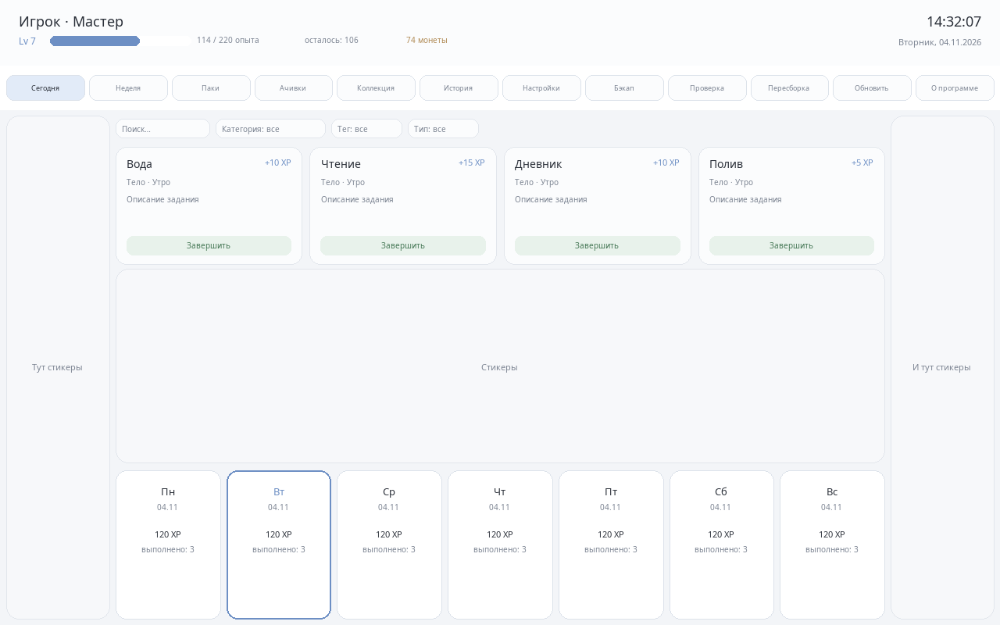

# Taskify

[English](README.en.md) · [Русский](README.ru.md) · [日本語](README.ja.md) · [Українська](README.uk.md) · [Polski](README.pl.md) · [Español](README.es.md) · [中文](README.zh.md) · **Deutsch**

Taskify ist eine lokale App zur Gamifizierung persönlicher Aufgaben für Windows. Führe Gewohnheiten, wiederkehrende und einmalige Aufgaben sowie Checklisten; sammle XP und Münzen; schalte Erfolge, Themen, Kosmetik und Sticker frei. Alles liegt auf deinem Rechner in einem JSONL-Event-Journal — ohne Konto und ohne Netzwerk.



## Funktionen

- Vier Aufgabenarten: Gewohnheiten, wiederkehrende Aufgaben, einmalige Aufgaben und Checklisten mit Unteraufgaben.
- Unbegrenzte Level, Tages- und Wochenfortschritt, Serien, Combos und Erfolge.
- Münzen, Kosmetikshop, Themen, Akzente, Hintergründe, Schriften, Sounds und verschiebbare Sticker.
- Inhaltspakete in TOML: Aufgaben, Kategorien, Tags, Icons, Paletten, Combos, Erfolge, Kosmetik und Bundles.
- Mehrere Livespaces: jeder mit eigener Historie, eigenen Käufen und eigenem Sticker-Board.
- Acht Oberflächensprachen: Russisch, Englisch, Japanisch, Ukrainisch, Polnisch, Spanisch, Chinesisch und Deutsch.
- Nur lokale Speicherung: Event-Journal, neu aufbaubare Caches und automatische Backups.
- Portabler Modus über `TASKIFY_HOME`.

## Voraussetzungen

- Windows 10 oder neuer.
- Rust 1.85 oder neuer.
- C++-Build-Tools, falls die Rust-Installation sie noch nicht enthält.

## Build und Start

```powershell
cargo build --release
.\target\release\taskify.exe
```

Dieselbe Datei bietet auch Kommandozeilenbefehle:

```powershell
.\target\release\taskify.exe version
.\target\release\taskify.exe packs
.\target\release\taskify.exe stats default
.\target\release\taskify.exe validate history default
```

Beim ersten Start wird der Livespace `default` angelegt und die eingebauten Pakete werden installiert.

## Daten

Standardmäßig liegt alles in `%APPDATA%\taskify`:

- `livespaces\<name>` — Journal `data/log/YYYY-MM.jsonl`, Caches `state.json` und `aggregates.json`, Backups.
- `packs\<id>` — installierte Inhaltspakete.
- `settings.toml` — Fenster- und App-Einstellungen.

Die Variable `TASKIFY_HOME` verschiebt das gesamte Datenverzeichnis an einen anderen Ort (portabler Modus). Das Journal ist die Quelle der Wahrheit: Caches können gelöscht und aus den Events neu aufgebaut werden.

## Kommandozeile

```text
taskify version
taskify packs [<data-root>]
taskify validate pack <paketpfad>
taskify validate all [<data-root>]
taskify validate history <livespace>
taskify stats <livespace>
taskify log <livespace> [--limit N]
taskify rebuild <livespace>
taskify backup <livespace>
taskify import <archiv.zip> <livespace> [<data-root>]
taskify export <livespace> <archiv.zip>
```

## Projektstruktur

| Crate | Zuständigkeit |
| --- | --- |
| `crates/core` | Aufgaben, Belohnungen, Levelkurve, Metriken, Tagesgrenzen. |
| `crates/store` | Events, Journal, Caches, Replay, Backups, Livespaces. |
| `crates/packs` | TOML-Pakete, Registries, Validator, Zip-Installation. |
| `crates/ui` | egui/eframe-Fenster, Screens, Spielregeln, Lokalisierung, CLI. |


## Pakete

Ein Paket ist ein Ordner mit `pack.toml` und Unterordnern für Aufgaben, Combos, Erfolge, Kosmetik, Bundles, Definitionen und Medien. IDs erhalten das Paketpräfix (`greeting/hello`). Eingebaute Pakete liegen in `assets/packs` und werden beim ersten Start installiert.

## Prüfungen

```powershell
cargo fmt --all --check
cargo clippy --workspace --all-targets -- -D warnings
cargo test --workspace
.\target\release\taskify.exe validate all
```

Der aktuelle Testsatz umfasst **155 Tests**.

## Mitwirken

Issues und Pull Requests sind willkommen. Führe vor einem Pull Request die Prüfungen oben aus und übersetze alle sichtbaren Texte in jede Sprache aus `crates/ui/src/i18n.rs`.

## Lizenz

Taskify steht unter der MIT-Lizenz. Siehe [LICENSE](LICENSE). Die mitgelieferten Noto-Schriften stehen unter der SIL Open Font License; siehe `assets/fonts/LICENSE-OFL.txt`.
